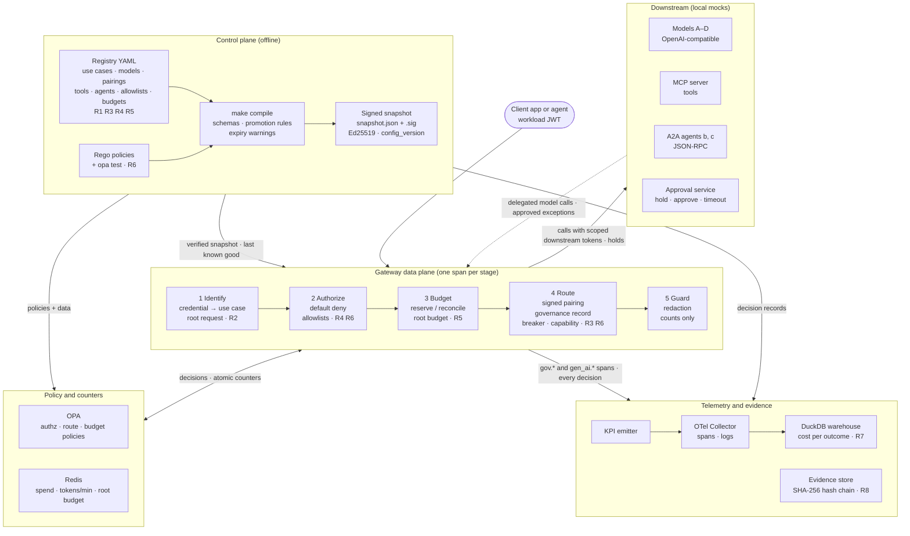

# Governed AI Gateway Prototype

Reference implementation evaluated in *From Onboarding to Business Value: A Reference Architecture for
Governed Enterprise AI Gateways* (IEEE Intelligent Systems submission). It shows that the four mechanisms of
the architecture can be built from open-source parts. It checks that they decide correctly in the eight
scenarios of the paper's Table 3, and it measures how much latency the gateway adds.

Everything is synthetic: models, tools and agents are local mocks, and there are no provider keys or real
organisation data. The build specification is in [SPEC.md](SPEC.md).

## Architecture (paper Figure 1)



Solid arrows are the request path and configuration flow; dotted arrows are calls back into the gateway (delegated agent model calls and approved one-time exceptions). R1–R8 mark where each requirement is enforced.

| Requirement | Where |
|---|---|
| R1 use-case registry and lifecycle | `control-plane/use_cases.yaml`; promotion rule and decision records in `cp_compile/compile.py` |
| R2 workload identity and attribution | `gateway/stages/identify.py`, `govlib/tokens.py` (workload JWT, root token, RFC 8693-style downstream token) |
| R3 model catalog, governance records, pairings | `control-plane/models.yaml`, `pairings.yaml`, `gateway/stages/route.py`, `policies/route.rego` |
| R4 tools and agents (MCP, A2A) | `tools.yaml`, `agents.yaml`, `allowlists.yaml`, `cp_compile/register.py`, `policies/authz.rego`, `gateway/core.py` |
| R5 budgets and quotas | `control-plane/budgets.yaml`, `gateway/stages/budget.py` (atomic Lua), `policies/budget.rego` |
| R6 policy as code, signed config | `control-plane/policies/*.rego` (+ `opa test`), `cp_compile/`, `gateway/snapshot.py` |
| R7 cost per outcome | `mocks/kpi_emitter/`, `telemetry/warehouse/` (DuckDB SQL) |
| R8 evidence | `telemetry/evidence_store/` (hash chain + verifier), OpenTelemetry spans |

Each of the five stages is its own function and its own span (`gateway.identify`, `gateway.authorize`,
`gateway.budget`, `gateway.route`, `gateway.guard`) under one `gateway.request` span. Model calls are
separate `gateway.upstream` spans.

## Reproduce

Prerequisites: Docker (Desktop) with Compose v2, Python 3.12, GNU make, and Git.

```bash
make all
```

`make all` runs `setup → fresh → compile → up → test → bench → report → verify-evidence`:

| target | does |
|---|---|
| `make setup` | creates `.venv` from `requirements.lock`, downloads the pinned OPA CLI (SHA-256 checked), generates Ed25519 keys into the git-ignored `keys/`, signs the pairings as the approving function |
| `make compile` | validates YAML against schemas, runs `opa test`, enforces promotion rules, warns about governance records expiring within 30 days, writes the signed `control-plane/build/snapshot.json` |
| `make up` / `make down` | starts or stops the Docker stack (OPA, Redis, OTel Collector, mocks, approval service, gateway) |
| `make test` | unit tests, the scenarios S1–S8 and the supplementary checks against the running stack, writing `results/scenarios.csv` and `results/supplementary.csv` |
| `make bench` | latency benchmark run as a container inside the compose network (avoids Docker Desktop port-forwarding latency), writing `results/latency.csv`, `stage_latency.csv` and `scenario_latency.csv` |
| `make report` | DuckDB cost per outcome, `results/environment.md`, and `results/summary.md` |
| `make verify-evidence` | verifies every evidence hash chain |
| `make register` | re-registers MCP tool hashes and A2A Agent Cards from the running mocks |

Approver CLI: `python -m approval_service.cli list --status pending`, then
`python -m approval_service.cli approve <hold_id> --model model-c --approver <name>`.

## How the results map to the paper

| Paper | File |
|---|---|
| Table 3 (decision correctness, evidence completeness, latency per scenario) | `results/summary.md`, `results/scenarios.csv`, `results/scenario_latency.csv` |
| Added latency (p50/p95, concurrency 1 and 10) | `results/latency.csv` |
| Per-stage latency | `results/stage_latency.csv` |
| Human approval wait (S4a), reported separately | `results/approval_wait.csv` |
| Cost per outcome | `results/cost_per_outcome.csv` |
| Environment and versions, attribute-name check against Table 2 | `results/environment.md` |

## Versions checked against current documentation

- MCP: the official Python SDK `mcp` 2.3.0. `FastMCP` is now `MCPServer`; the server uses streamable HTTP.
- A2A: protocol 1.0 with the JSON-RPC binding. The Agent Card is at `/.well-known/agent-card.json` and the
  method is `SendMessage`. Both were checked against `a2a-sdk` 1.3.1, and cards are validated against its
  protobuf `AgentCard`. The SDK is gRPC/protobuf-first, so the agents are a minimal spec-following JSON-RPC
  server, as SPEC.md allows.
- OpenTelemetry semantic conventions 1.44.0 (`opentelemetry-semantic-conventions` 0.66b2). All `gen_ai.*`
  names in SPEC.md 6.1 match.

## Deterministic rules used by the mocks

- **Tokens:** one token per whitespace-separated word of the message text. The mock model returns exactly
  `max_tokens` words, so output tokens equal `max_tokens`.
- **Prices:** synthetic USD per 1k tokens, from `models.yaml`. The gateway reports cost in `gov.cost.amount`.
- **Budget estimate:** input tokens + `max_tokens`, priced at the most expensive paired model, then
  reconciled to actual usage after the response.

## Limitations

- **Mocks only.** Models, MCP tools and A2A agents are local mocks. Their latency is not provider latency.
- **Single machine.** All services run in one Docker host. The latencies include localhost container
  networking, and the gateway runs as one uvicorn worker (uvloop + httptools). At concurrency 10 it
  saturates one CPU core, so the added latency there is mostly queueing. Circuit-breaker state and the tool quarantine are
  in-process.
- **Designed behaviour, not attack resistance.** The prototype shows that the controls decide as designed.
  It has not been hardened or penetration-tested. Examples:
  - Admin and internal endpoints use shared tokens.
  - The simulated IdP key is shared with the mock agents.
  - Evidence and head files sit on the same disk, so an attacker who can rewrite both can forge a chain.
  - The MCP mock does not itself validate the downstream token (the A2A agents do).
- **Delegated budget.** The root-request budget relies on agents forwarding the gateway-minted delegation
  token. Agents that bypass the gateway are out of scope.
- **Evidence timing.** Evidence records are written asynchronously in order, off the request's critical
  path. Spans are batched by the OpenTelemetry SDK.

## Ownership and license

The architecture, requirements, design and build specification are by Ankit Khujneri
([akcodian](https://github.com/akcodian)), who owns this repository.

Released under the MIT License (see [LICENSE](LICENSE)). Copyright (c) 2026 Ankit Khujneri.
